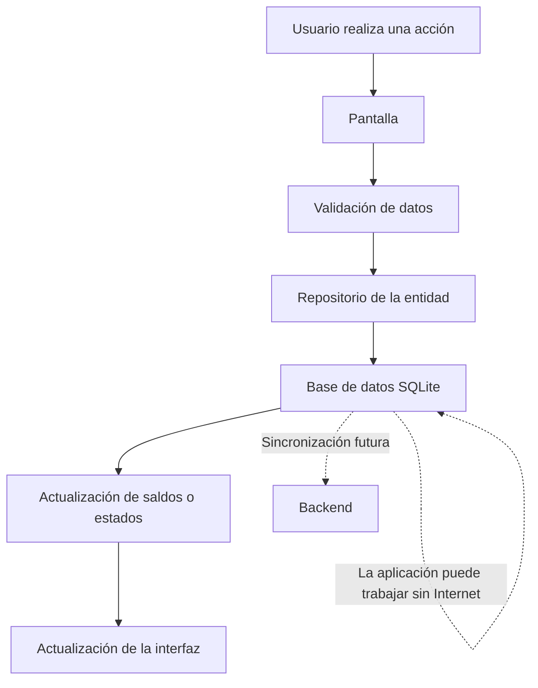

# Base de datos local de AHRE

## Objetivo

AHRE utiliza un enfoque offline-first. Las operaciones financieras principales deben poder realizarse sin conexión a Internet y la información debe guardarse localmente antes de considerar cualquier comunicación con un backend.

El flujo general será:

```text
usuario realiza una operación
→ AHRE valida la información
→ se guarda en SQLite
→ se actualizan los saldos o estados relacionados
→ la interfaz muestra el resultado
```

Este documento define la tecnología y el modelo inicial. La estructura SQLite,
las migraciones y la capa base de repositorios están descritas en
[`implementacion.md`](implementacion.md). La lógica funcional de cada módulo
seguirá incorporándose en sus Issues correspondientes.

## Tecnología seleccionada

La persistencia principal será `expo-sqlite`.

La elección se debe a que AHRE necesita:

- almacenar información relacionada;
- consultar movimientos por depósito, categoría y fecha;
- calcular saldos;
- trabajar sin conexión;
- conservar los datos entre reinicios de la aplicación;
- dejar preparada una futura sincronización.

`expo-secure-store` se utilizará para conservar el identificador de la sesión local en el dispositivo. Las contraseñas no se guardan allí ni en texto plano: SQLite conserva solamente su verificador derivado.

No se utilizará `AsyncStorage` como base principal porque el modelo de AHRE necesita relaciones y consultas estructuradas.

## Convenciones de la base de datos

- Los nombres de tablas y campos estarán en español.
- Se utilizará `snake_case`.
- No se utilizarán tildes ni caracteres especiales en nombres de tablas o campos.
- Los identificadores serán textos generados localmente.
- Los montos utilizarán el campo `monto` sin agregar campos adicionales de centavos.
- Las fechas se guardarán como texto en formato ISO 8601.
- Las tablas financieras no se eliminarán físicamente cuando se necesite conservar el historial.

Ejemplos:

```text
depositos
fecha_creacion
deposito_id
monto
```

## Entidades principales

### `usuarios`

Representa al usuario local de AHRE.

| Campo | Tipo | Descripción |
| --- | --- | --- |
| `id` | `TEXT` | Identificador local del usuario. |
| `nombre` | `TEXT` | Nombre visible del usuario. |
| `correo_electronico` | `TEXT` | Correo obligatorio y único sin distinguir mayúsculas de minúsculas. |
| `activo` | `INTEGER` | Indica si el usuario está activo. |
| `fecha_creacion` | `TEXT` | Fecha de creación. |
| `fecha_actualizacion` | `TEXT` | Última modificación. |

El correo se normaliza con espacios externos quitados y letras minúsculas antes
de guardarlo. La base también aplica un índice único sobre `LOWER(correo_electronico)`.
El verificador de contraseña vive en `credenciales_usuario`, separado de los
datos de perfil.

### `credenciales_usuario`

Guarda el material local requerido para comprobar la contraseña de una cuenta.

| Campo | Tipo | Descripción |
| --- | --- | --- |
| `usuario_id` | `TEXT` | Usuario asociado; también es la clave primaria. |
| `contrasena_verificador` | `TEXT` | Cadena con algoritmo, parámetros, sal aleatoria y resultado derivado; nunca contiene la contraseña original. |
| `fecha_creacion` | `TEXT` | Fecha de creación del verificador. |
| `fecha_actualizacion` | `TEXT` | Última modificación del verificador. |

La implementación actual almacena un SHA-256 de la contraseña y una sal
aleatoria de 16 bytes, calculado con `expo-crypto`. No guarda la contraseña en
texto plano. Este hash rápido ofrece menos resistencia ante intentos de
adivinación offline que un algoritmo de derivación lenta. Los verificadores de
cuentas locales creados con formatos anteriores no se convierten; durante el
desarrollo se limpia la base local y se crea la cuenta nuevamente al cambiar
este formato.

### `preferencias`

Guarda las preferencias básicas del usuario.

| Campo | Tipo | Descripción |
| --- | --- | --- |
| `id` | `TEXT` | Identificador local. |
| `usuario_id` | `TEXT` | Usuario al que pertenecen las preferencias. |
| `deposito_predeterminado_id` | `TEXT` | Depósito utilizado por defecto. |
| `notificaciones_activas` | `INTEGER` | Indica si las notificaciones están activas. |
| `idioma` | `TEXT` | Idioma elegido: `es` o `en`. |
| `apariencia` | `TEXT` | Apariencia elegida: `sistema`, `claro` u `oscuro`. |
| `fecha_creacion` | `TEXT` | Fecha de creación. |
| `fecha_actualizacion` | `TEXT` | Última modificación. |

Cada usuario tendrá como máximo un registro de preferencias.
El registro local crea las preferencias en la misma transacción que el usuario
y su verificador. `deposito_predeterminado_id` comienza en `NULL` y
`notificaciones_activas` en `1`, `idioma` en `es` y `apariencia` en `sistema`.

### `depositos`

Representa los lugares donde el usuario tiene dinero.

| Campo | Tipo | Descripción |
| --- | --- | --- |
| `id` | `TEXT` | Identificador local. |
| `usuario_id` | `TEXT` | Usuario propietario. |
| `nombre` | `TEXT` | Nombre del depósito. |
| `tipo` | `TEXT` | `efectivo`, `banco` o `billetera_virtual`. |
| `saldo_inicial` | `REAL` | Saldo con el que se crea el depósito. |
| `saldo_actual` | `REAL` | Saldo vigente, actualizado junto con cada movimiento. |
| `icono` | `TEXT` | Identificador del ícono utilizado. |
| `color` | `TEXT` | Color opcional del depósito. |
| `descripcion` | `TEXT` | Descripción opcional. |
| `activo` | `INTEGER` | Indica si acepta nuevos movimientos. |
| `fecha_creacion` | `TEXT` | Fecha de creación. |
| `fecha_actualizacion` | `TEXT` | Última modificación. |

Un depósito solamente tiene un tipo. No tiene categorías asociadas. Las
categorías se utilizan en los movimientos que afectan al depósito.

`saldo_actual` guarda el último saldo conocido para consultarlo directamente.
`saldo_inicial` conserva el importe de apertura y los movimientos mantienen el
historial de cambios. Cada alta, actualización o reversión de un movimiento
actualiza `saldo_actual` dentro de la misma transacción.

El saldo vigente parte de `saldo_inicial` hasta la primera conciliación. Luego,
parte del último `saldo_informado` más las variaciones de los movimientos
registrados desde esa conciliación. Si el usuario informa otro saldo vigente,
se guarda el saldo anterior y el informado en `historial_saldos_deposito`; esa
conciliación no modifica los movimientos previos. Las consultas leen
`saldo_actual` directamente.

### `historial_saldos_deposito`

Conserva las conciliaciones manuales del saldo de cada depósito.

| Campo | Tipo | Descripción |
| --- | --- | --- |
| `id` | `TEXT` | Identificador local. |
| `deposito_id` | `TEXT` | Depósito conciliado. |
| `saldo_anterior` | `REAL` | Saldo guardado antes de la conciliación. |
| `saldo_informado` | `REAL` | Saldo que informó el usuario. |
| `descripcion` | `TEXT` | Nota opcional sobre la conciliación. |
| `fecha_hora` | `TEXT` | Momento de la conciliación. |

`depositosRepositorio.actualizarSaldoInformado()` registra la conciliación y
actualiza el saldo vigente en la misma transacción. Los movimientos posteriores
continúan actualizando ese saldo por sus variaciones.

### `movimientos`

Representa ingresos, egresos y los movimientos generados por una transferencia.

| Campo | Tipo | Descripción |
| --- | --- | --- |
| `id` | `TEXT` | Identificador local. |
| `deposito_id` | `TEXT` | Depósito afectado. |
| `categoria` | `TEXT` | Categoría definida en el enum de movimientos. |
| `recurrencia_id` | `TEXT` | Recurrencia relacionada, si corresponde. |
| `transferencia_id` | `TEXT` | Transferencia relacionada, si corresponde. |
| `tipo` | `TEXT` | `ingreso`, `egreso`, `transferencia_salida` o `transferencia_entrada`. |
| `monto` | `REAL` | Monto del movimiento. |
| `descripcion` | `TEXT` | Descripción del movimiento. |
| `fecha_hora` | `TEXT` | Momento en que ocurrió. |
| `anulado` | `INTEGER` | Indica si el movimiento fue anulado. |
| `reversion_de_id` | `TEXT` | Movimiento original que compensa, si corresponde. |
| `fecha_creacion` | `TEXT` | Fecha de creación. |
| `fecha_actualizacion` | `TEXT` | Última modificación. |

Al eliminar un ingreso o egreso, el movimiento original se conserva y se crea
otro movimiento del mismo monto y depósito, con el tipo opuesto. `reversion_de_id`
lo vincula al original; ambos movimientos actualizan el saldo y su efecto neto
es cero. La compensación usa `devoluciones` para un egreso revertido y
`otros_gastos` para un ingreso revertido, según las categorías válidas del tipo.
No se elimina físicamente el movimiento original.

Las categorías no son una tabla. Son valores predefinidos por AHRE y se
definen en `src/constants/movimientos.js` como `CATEGORIAS_INGRESO` y
`CATEGORIAS_EGRESO`.

Categorías iniciales para ingresos:

```text
sueldo
trabajo_independiente
ventas
transferencias_recibidas
devoluciones
inversiones
prestamos_recibidos
regalos
becas_ayudas
otros_ingresos
```

Categorías iniciales para egresos:

```text
alimentacion
transporte
hogar
servicios
suscripciones
salud
educacion
entretenimiento
compras
trabajo
deudas
transferencias
impuestos
viajes
regalos
mascotas
otros_gastos
```

SQLite guardará el valor como `TEXT`; la aplicación validará que corresponda
con una categoría permitida para el tipo de movimiento.

### `transferencias`

Representa el traspaso de dinero entre dos depósitos del mismo usuario.

| Campo | Tipo | Descripción |
| --- | --- | --- |
| `id` | `TEXT` | Identificador local. |
| `usuario_id` | `TEXT` | Usuario propietario. |
| `deposito_origen_id` | `TEXT` | Depósito desde el que sale el dinero. |
| `deposito_destino_id` | `TEXT` | Depósito al que llega el dinero. |
| `monto` | `REAL` | Monto transferido. |
| `fecha_hora` | `TEXT` | Momento de la transferencia. |
| `descripcion` | `TEXT` | Descripción opcional. |
| `anulada` | `INTEGER` | Indica si la transferencia fue anulada. |
| `reversion_de_id` | `TEXT` | Transferencia original que compensa, si corresponde. |
| `fecha_creacion` | `TEXT` | Fecha de creación. |
| `fecha_actualizacion` | `TEXT` | Última modificación. |

Cada transferencia genera dos movimientos relacionados mediante `transferencia_id`:

```text
depósito origen  → transferencia_salida
depósito destino → transferencia_entrada
```

La transferencia no representa un ingreso o egreso real del usuario ni mueve
dinero fuera de AHRE. Registra el traspaso y actualiza los saldos de los dos
depósitos.

Al eliminar una transferencia, se conserva y se marca como anulada. AHRE crea
otra transferencia en sentido inverso y sus dos movimientos compensatorios; así
se conserva el historial y se restauran ambos saldos.

### `recurrencias`

Define la configuración de movimientos repetitivos.

| Campo | Tipo | Descripción |
| --- | --- | --- |
| `id` | `TEXT` | Identificador local. |
| `deposito_id` | `TEXT` | Depósito afectado. |
| `categoria` | `TEXT` | Categoría definida en el enum de movimientos. |
| `tipo` | `TEXT` | `ingreso` o `egreso`. |
| `monto` | `REAL` | Monto previsto. |
| `descripcion` | `TEXT` | Descripción del movimiento repetitivo. |
| `frecuencia` | `TEXT` | `diaria`, `semanal`, `mensual` o `anual`. |
| `fecha_inicio` | `TEXT` | Inicio de la recurrencia. |
| `fecha_fin` | `TEXT` | Final opcional. |
| `proxima_ejecucion` | `TEXT` | Próxima fecha prevista. |
| `activa` | `INTEGER` | Indica si continúa activa. |
| `fecha_creacion` | `TEXT` | Fecha de creación. |
| `fecha_actualizacion` | `TEXT` | Última modificación. |

En este Issue no se implementa la ejecución automática de recurrencias.

## Entidades sociales y deudas

El esquema inicial ya admite el modelo personal offline de Social: personas con
nombre, apellido y apodo, salas, pertenencias, ítems con su propio pagador,
participaciones, deudas propias y un registro común de pagos.

| Tabla | Finalidad |
| --- | --- |
| personas | Agenda por usuario; eliminar desactiva sin borrar identidad ni historial. |
| salas | Ocasiones abiertas o cerradas, con máximo de tres abiertas por cuenta. |
| personas_sala | Pertenencias actuales e históricas; retirar no cambia repartos anteriores. |
| gastos_compartidos | Ítems independientes con pagador propio y reparto igual o manual. |
| participantes_gasto | Parte asignada y orden estable por persona e ítem. |
| deudas | Obligaciones con Vos como deudor o acreedor; una por participación pendiente al cierre. |
| pagos_sociales | Compras, entregas de partes y pagos de deudas manuales, sin copiar filas al cerrar. |

El [contrato de Social](social.md) detalla campos, índices, restricciones y
responsabilidades de los servicios. Los [diagramas exclusivos de Social](../diagramas/social/README.md)
explican los recorridos y las relaciones de estas tablas.

Una compra pagada por Vos exige un egreso completo. Una compra pagada por otra
persona no utiliza tus depósitos. Las entregas propias generan o vinculan un
movimiento en la dirección correspondiente; entre terceros quedan solo en la
sala. El movimiento es único en todo el registro social de pagos.

Las deudas entre terceros no se insertan en tu registro personal: se conservan
como partes y pagos de la sala. Desactivar un contacto no cancela sus deudas ni
impide saldar registros anteriores. Los ítems abiertos conservan su plan de pagos
y asociaciones en plan_pagos sin modificar saldos. El cierre crea compras,
entregas y movimientos nuevos, vincula los existentes sin duplicarlos y genera
solo obligaciones pendientes que te involucran, en una única transacción.

La deuda manual a cobrar guarda el egreso del adelanto. El vínculo único
`pagos_sociales.clase = origen_deuda` identifica el movimiento sin contarlo como
devolución. Le debo no crea ingresos ni modifica depósitos al registrarse; su
pago genera el egreso. Se puede vincular un movimiento previo para no duplicarlo.

La [especificación funcional](../funcionalidades/social.md) describe la integración
actual. Las pantallas consultan los servicios de `src/social/`, que escriben en
los repositorios adaptados y coordinan pagos y movimientos en una transacción.

## Ejemplo: transferencia entre depósitos

Una transferencia entre depósitos no se registra como un ingreso o egreso
personal. Se registra como una operación propia con un depósito de origen y uno
de destino.

```text
seleccionar depósito de origen
→ seleccionar depósito de destino
→ ingresar monto
→ crear transferencia
→ crear egreso de transferencia en el origen
→ crear ingreso de transferencia en el destino
→ actualizar ambos saldos
```

```text
Depósito A
    │ transferencia_salida: $500
    ▼
Depósito B
    ▲ transferencia_entrada: $500
```

## Flujo general offline-first



## Flujo de un movimiento

```text
usuario completa el formulario
→ se valida el tipo, monto, depósito y categoría
→ se crea el movimiento local
→ se actualiza el saldo calculado
→ la pantalla consulta los datos actualizados
```

## Flujo de una deuda

```text
se registra la deuda
→ se guarda el monto total
→ se registran pagos parciales o totales
→ se calcula el monto pendiente
→ se actualiza el estado de la deuda
```

## Reglas de eliminación

### Movimientos

No se eliminan físicamente ni se excluyen del historial. Se crea un movimiento
opuesto enlazado mediante `reversion_de_id`; el original y la reversión quedan
registrados.

### Depósitos

Si tienen movimientos asociados, se desactivan mediante `activo`. No se eliminan para conservar el historial.

### Recurrencias

Se desactivan mediante `activa`. Los movimientos que ya hayan sido generados permanecen guardados.

### Deudas

Se conservan y se cambia su estado a `cancelada` cuando corresponda.

### Gastos compartidos

El ítem se conserva con estado `cancelado`. Antes de cancelarlo deben corregirse
sus compras y entregas mediante operaciones coordinadas. No se borran pagos ni
se compensan movimientos automáticamente por cambiar ese estado.

## Acceso a la base de datos

Las pantallas no ejecutarán consultas SQL directamente. La comunicación seguirá esta separación:

```text
pantalla
→ repositorio
→ SQLite
→ resultado
→ actualización de la interfaz
```

La estructura actual separa el esquema y sus repositorios:

```text
src/database/
├── initialization.js
├── transactions.js
├── migrations/
│   └── 001_initialSchema.js
└── repositories/
    ├── peopleRepository.js
    ├── sharedExpensesRepository.js
    ├── sharedExpenseParticipantsRepository.js
    ├── debtsRepository.js
    ├── roomsRepository.js
    ├── roomPeopleRepository.js
    ├── socialPaymentsRepository.js
    └── ... repositorios financieros existentes
```

Los repositorios sociales usan el esquema actual. Los servicios coordinan
validaciones y transacciones, sin SQL dentro de las pantallas.

Las categorías predefinidas se mantendrán en `src/constants/` porque no son
datos almacenados en una tabla.

Los repositorios financieros conservan sus reglas de saldo. Social los utiliza
para crear o vincular movimientos; las reversiones mantienen el pago y la deuda
coherentes mediante `socialMovementReversal.js`.

## Implementación

La primera versión de SQLite conserva este modelo y sus tablas. Las categorías
continúan como catálogos constantes del código y no se almacenan en una tabla;
la implementación y las restricciones efectivas se detallan en
[`implementacion.md`](implementacion.md).
