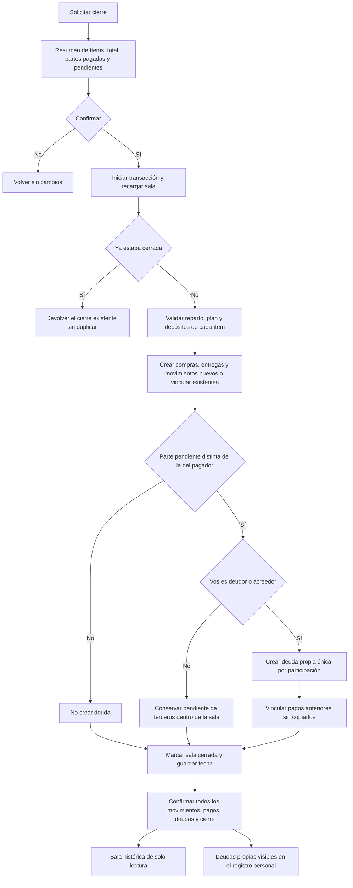
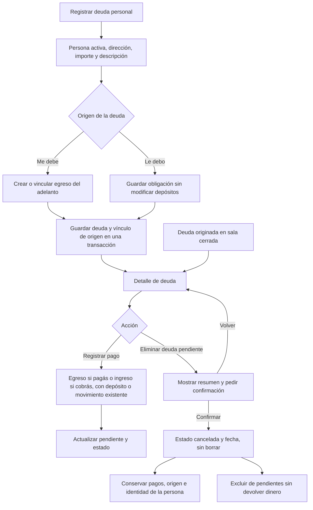

# Cierre de sala y deudas propias

## Cierre

El recorrido I a O se aplica a todas las partes. Una sala vacía, completamente
pagada o con pendientes exclusivamente entre terceros se cierra sin crear
deudas personales. Retirar a una persona no excluye sus partes del cierre.

La deuda conserva el importe original de la parte; el pendiente resta las
entregas anteriores y futuras. Si tu parte es $4.000 y ya entregaste $1.000,
el registro muestra $4.000 originales y $3.000 pendientes. No se crea otro
egreso si esos $1.000 ya tenían un movimiento vinculado. Los movimientos nuevos
preparados en el borrador sí se crean durante el cierre.

## Deuda personal y cancelación

Una persona desactivada sigue identificada y sus deudas previas pueden saldarse.
No hay compensación automática entre lo que debés y lo que te deben. Los pagos
posteriores a un cierre actualizan tus deudas; el reparto original de la sala
y su historial entre terceros permanecen de solo lectura.

El movimiento de origen no es una devolución y no reduce el pendiente. Un
adelanto de $800 genera un egreso; cobrarlo devuelve esos $800 mediante un
ingreso. Usar un movimiento existente conserva su depósito y no vuelve a
afectar el saldo. Revertir el origen requiere corregir primero devoluciones
vigentes y luego cancela la deuda; eliminar solo la deuda no devuelve dinero.
Al saldar se confirma Deuda saldada y se vuelve al inicio de Social. Las deudas
saldadas permanecen en el historial y no se pueden eliminar.
