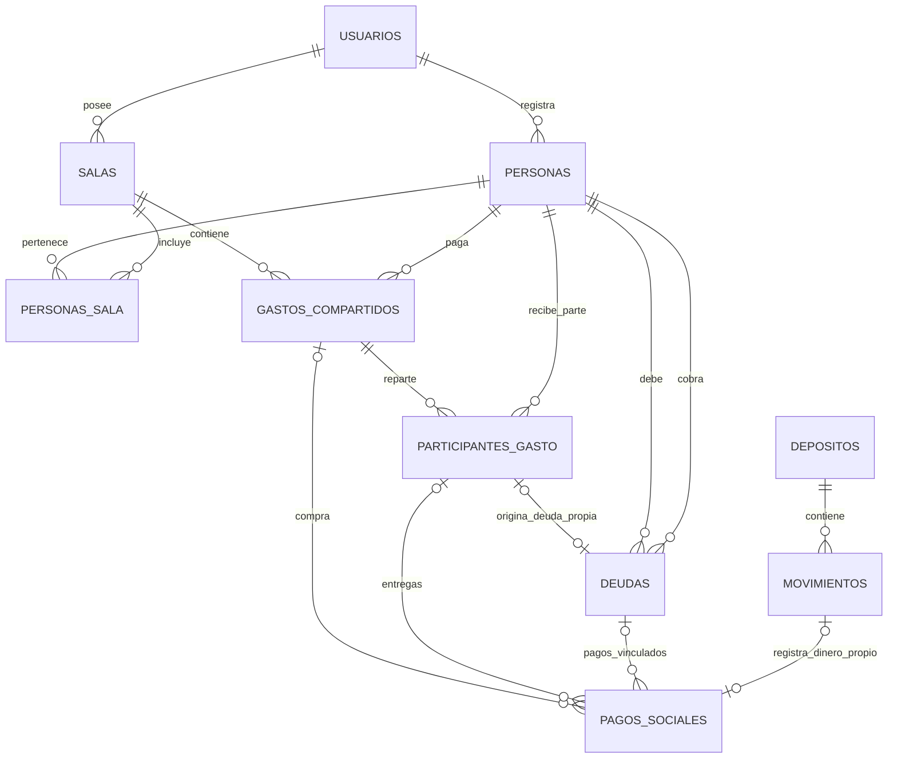
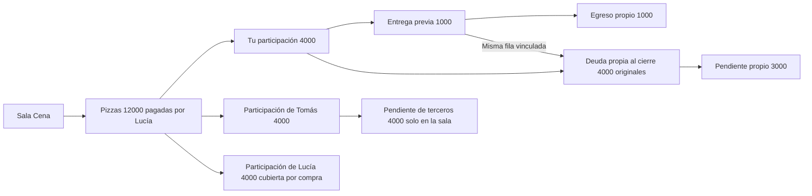

# Modelo de datos de Social

Todas las relaciones sociales conservan el usuario propietario. Las claves
foráneas compuestas impiden asociar personas, salas o pagos de distintas cuentas.
Solo una persona por cuenta representa a Vos. No se insertan ejemplos al iniciar.
En salas abiertas, gastos_compartidos.plan_pagos guarda como JSON las personas
marcadas como pagadas y las asociaciones de depósito o movimiento. No existen
pagos confirmados hasta el cierre; entonces se generan las filas y movimientos
en una misma transacción. Los planes se validan al guardar y al cerrar.

## Clases del registro común de pagos

| Clase | Referencia requerida | Referencia opcional | Dinero propio |
| --- | --- | --- | --- |
| `compra` | Ítem | Ninguna deuda o participación | Egreso solo si Vos pagó el ítem |
| `parte` | Participación | Deuda de esa misma participación al cerrar | Egreso si Vos entrega, ingreso si Vos recibe; sin movimiento entre terceros |
| `deuda` | Deuda personal sin participación | Ningún ítem o participación | Egreso o ingreso según el extremo propio |
| `origen_deuda` | Deuda personal a cobrar sin participación, una sola fila por deuda | Ningún ítem o participación | Egreso del adelanto |

`movimiento_id` es único en toda la tabla de pagos, incluyendo las compras.
El mismo pago no se copia al cerrar: se completa su `deuda_id` cuando corresponde.
La compra no se suma como entrega de una parte. La parte del pagador se deriva
como cubierta por su compra; no crea una entrega consigo mismo.
El origen de deuda tampoco se suma como devolución ni reduce el pendiente.
Le debo no crea movimiento ni origen inicial: genera un egreso al pagarse.

## Ejemplo de vínculos

Los estados abierta/cerrada pertenecen a la sala; vigente/cancelado al ítem;
pendiente/parcial/pagada/cancelada a la deuda; vigente/anulado al pago. Los
totales y el pendiente se consultan desde importes y pagos vigentes, no desde
las cadenas de presentación de la maqueta.
