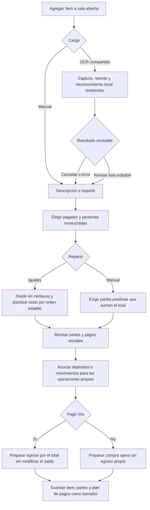
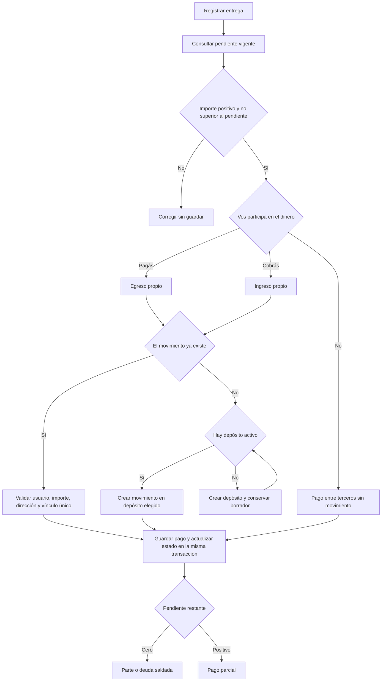
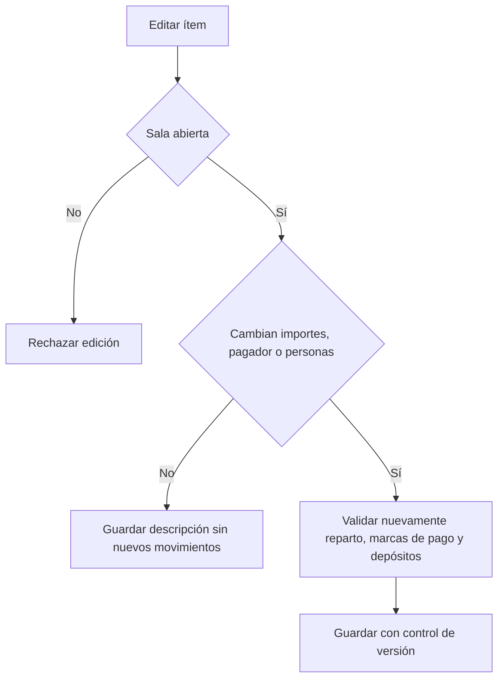

# Ítems y pagos

## Registro y reparto de un ítem

El pagador puede estar fuera del reparto; si participa, su parte está cubierta
por la compra y no provoca otro pago. Un ítem tiene un solo pagador. La lectura
OCR no crea por adelantado un egreso. Devuelve la lista al registro de Social;
la carga manual y la reconocida comparten validación y guardado atómico.
Guardar un ítem tampoco crea el egreso: los movimientos nuevos y pagos se
confirman al cerrar la sala. El borrador reserva los movimientos ya existentes
para impedir que se vuelvan a usar en otro gasto o pago social.

## Entregas de partes y deudas

Todos pagaron prepara una entrega por cada pendiente, excepto la parte del
pagador. Se revisan los depósitos y movimientos propios antes de confirmar.
Los pagos entre terceros solo se registran mientras la sala está abierta.
Vincular un movimiento existente no altera nuevamente el saldo. Dos entregas
legítimas del mismo importe son válidas; la prevención de reintentos usa una
clave de operación, no una comparación de textos o importes.

## Edición

En una sala abierta todavía no hay pagos confirmados: corregir el borrador
no requiere compensaciones. Las referencias con historial financiero confirmado
siguen protegidas; una sala cerrada no se edita.
