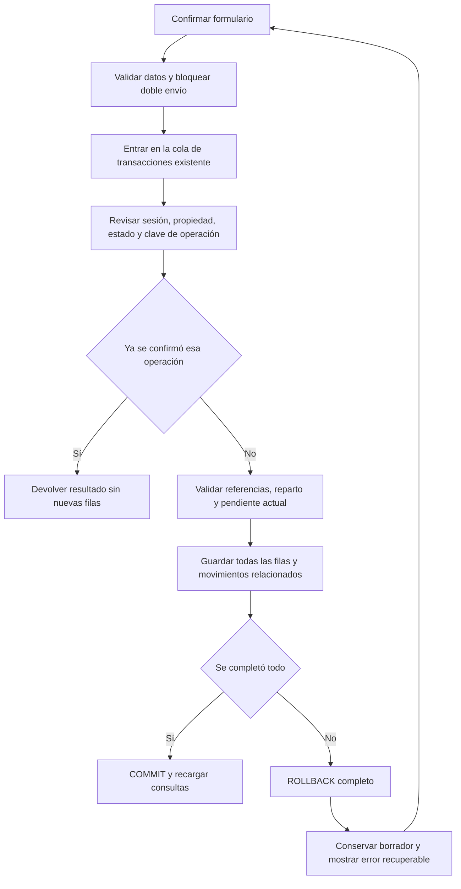
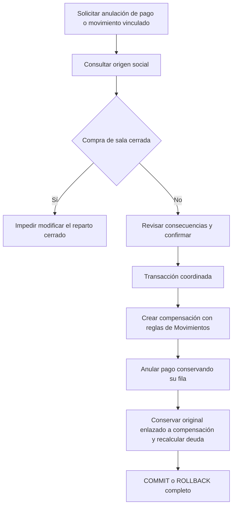

# Integridad y errores de Social

## Escritura y reintento

Se prueban cuenta ajena, registro inexistente, persona desactivada para nuevas
selecciones, depósito inactivo, sala cerrada, falta de cupo, sobrepago,
movimiento ya vinculado y fallo intermedio de escritura. La base no calcula
automáticamente saldos ni crea deudas al cambiar un estado.

## Corrección de un pago propio

El repositorio de movimientos ejecuta este flujo con `socialMovementReversal.js`.
Una compra abierta con entregas vigentes exige corregirlas antes; al revertir
una compra abierta se cancela su ítem. Un pago confirmado no cambia de importe,
fecha, origen o movimiento: se anula y se registra otro. Una compensación ni
un original ya revertido pueden usarse como un pago nuevo.

En un origen de deuda manual, se bloquea la reversión mientras queden devoluciones
vigentes. Una vez corregidas, se compensa el movimiento y se cancela la obligación;
el origen se excluye de las sumas usadas para recalcular el pendiente de una deuda.

## Alcance de la validación

El esquema protege claves, referencias por cuenta, clases de pagos, importes,
dirección y unicidad del movimiento, deudas propias y estados de solo lectura.
La normalización de nombres, suma exacta del reparto, actualización de estados,
autorización de sesión y atomicidad del cierre corresponden a los servicios.
Las pruebas de esquema y servicios usan SQLite en memoria. Las de interfaz
recorren componentes reales con controles nativos adaptados en ambos temas;
no reemplazan Expo SQLite ni la revisión visual en dispositivo.

La versión inicial del esquema se conserva. Estos cambios requieren una base
de desarrollo nueva; no convierten ni borran automáticamente bases anteriores.
No se debe descartar una base que contenga información personal real.
