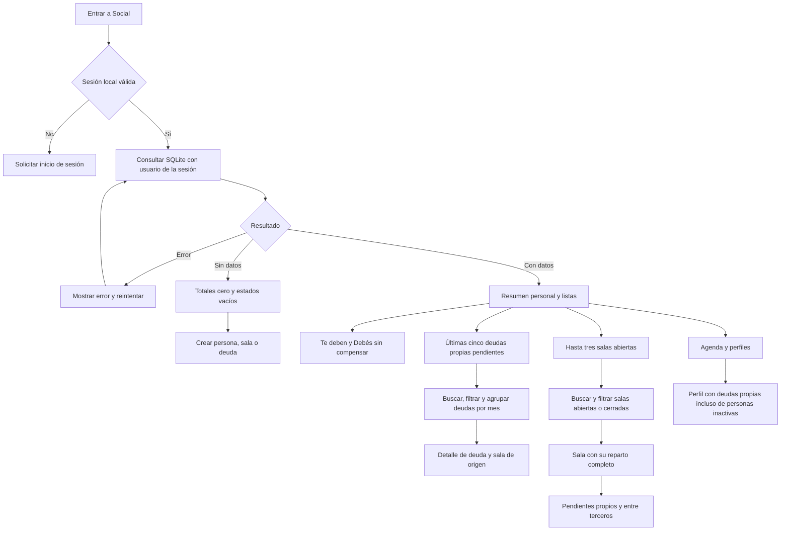

# Entrada y consultas de Social

Los totales personales se obtienen de deudas vigentes que tienen a Vos en uno
de sus extremos. No se filtran por actividad del contacto. Las partes de salas
abiertas siguen siendo provisionales y se consultan dentro de la sala; las
obligaciones entre terceros nunca se incorporan a tus totales.

Buscar, filtrar, plegar meses o consultar detalles no escribe datos. Al volver
de un formulario se recargan las consultas; reiniciar o cambiar de cuenta no
recupera ejemplos ni datos del usuario anterior. Los estados de carga, error,
sin registros y sin coincidencias son distintos.
