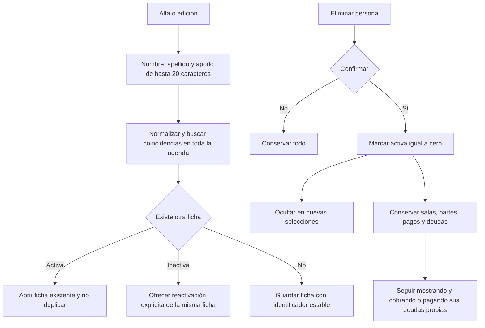
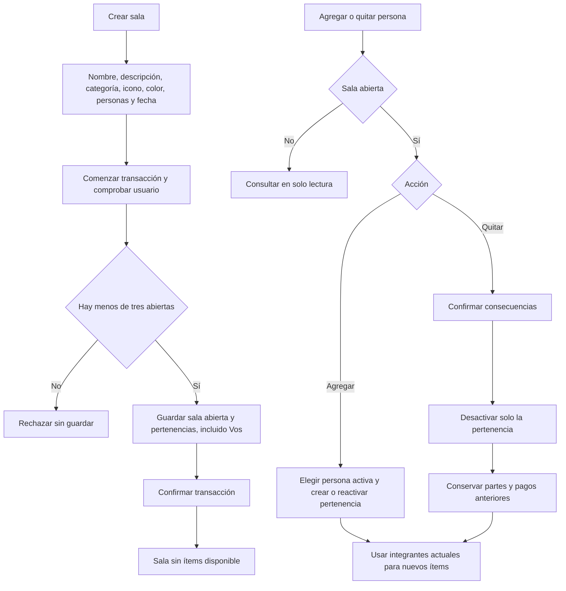

# Personas y salas

## Agenda

Editar excluye la misma ficha de la comparación. Las claves normalizadas
también son únicas para contactos inactivos. Vos es una representación interna
única por cuenta y no puede desactivarse. No se borran filas de personas.

## Creación y pertenencia

No se redistribuyen ítems anteriores al agregar o quitar personas. Quien fue
retirado puede seguir teniendo pagos o pendientes históricos. Desactivar una
persona en la agenda y retirarla de una sala son operaciones distintas. La
fecha de la ocasión y la de creación se guardan por separado; una sala cerrada
libera un lugar entre las tres abiertas.
